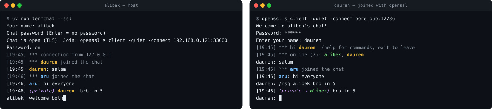

# termchat

[](https://github.com/aribekkuu/whatsup-python/actions/workflows/tests.yml)

A multi-user chat that runs in the terminal, built with plain Python sockets and threads — **standard library only**.

You start the server and chat from its console as the host. Everyone else joins with a single command — `nc` or `openssl` — so they don't need Python, this code, or any app installed.



## Features

- **Full-duplex chat** — messages appear instantly, even while you're typing. Incoming lines are inserted *above* your input line, so half-typed text is never lost.
- **Group chat** — any number of participants, one thread per client.
- **Commands** — `/who`, `/msg` (private messages), `/kick` (host only), `/help`.
- **Timestamps and colored nicknames.**
- **Password protection** — optional; 3 attempts with a delay, constant-time comparison.
- **TLS encryption** (`--ssl`) — participants connect with the built-in `openssl` client.
- **Input sanitizing** — control characters are stripped, so nobody can clear other people's screens or forge messages with ANSI escape codes.
- **Tested** — 31 tests that run a real server and connect real sockets.

## Quick start

```bash
git clone https://github.com/aribekkuu/termchat.git
cd termchat
uv run termchat
```

Enter your name and an optional password. Participants on the same network join with:

```bash
nc <host-ip> 33000
```

The server prints the exact command with your IP at startup.

## Encrypted mode

Create a self-signed certificate once:

```bash
openssl req -x509 -newkey rsa:2048 -nodes -keyout key.pem -out cert.pem -days 365 -subj "/CN=chat"
```

Then:

```bash
uv run termchat --ssl                                  # host
openssl s_client -quiet -connect <host-ip>:33000       # participants
```

A `self signed certificate` warning is expected — the connection is still encrypted. `*.pem` files are git-ignored; never commit `key.pem`.

### Options

```
uv run termchat [--port 33000] [--ssl] [--cert cert.pem] [--key key.pem] [--password PASSWORD]
```

Without `--password` you're asked at startup (input hidden). Press Enter for an open chat.

## Chatting over the internet

`192.168.x.x` is only reachable inside your home network. To let friends anywhere join without installing anything, open a tunnel with [bore](https://github.com/ekzhang/bore):

```bash
brew install bore-cli
uv run termchat --ssl                  # terminal 1
bore local 33000 --to bore.pub         # terminal 2 → "listening at bore.pub:12736"
```

Friends run `openssl s_client -quiet -connect bore.pub:12736`. The port changes every time bore restarts. Anyone who finds the port can try to connect, so use a password and `--ssl`.

**Alternative:** [Tailscale](https://tailscale.com/) puts you and your friends in a private network — nothing is exposed publicly and the address never changes, but everyone needs the app.

## Commands

| Command | Who | Description |
|---|---|---|
| `/who` | everyone | List who's online |
| `/msg <name> <text>` | everyone | Private message — only the recipient sees it |
| `/kick <name>` | host | Remove a participant |
| `/help` | everyone | Show commands |
| `exit` | everyone | Leave (host: close the chat for everyone) |

## Joining from Windows

Windows ships neither `nc` nor `openssl`. Use **ncat** from [Nmap](https://nmap.org/download) (`ncat <host> 33000`, or `ncat --ssl <host> 33000`), WSL, or Git Bash. Windows Terminal renders the colors correctly.

## Project structure

```
.
├── src/termchat/
│   ├── __main__.py     # CLI: arguments, name/password prompts, startup banner
│   ├── server.py       # ChatServer: threads, auth, routing, broadcast
│   ├── commands.py     # /who, /msg, /kick, /help
│   ├── terminal.py     # timestamps, colors, sanitizing, the input-line trick
│   ├── tls.py          # TLS context for --ssl
│   └── config.py       # port, limits, colors, name rules
├── tests/              # pytest suite against a real running server
├── docs/demo.svg       # screenshot in this README
└── .github/workflows/  # CI: tests on Linux and macOS
```

## How it works

```
                    ChatServer
 participant ──► _serve thread ──┐
 participant ──► _serve thread ──┼──► broadcast() ──► everyone else
 participant ──► _serve thread ──┘
                 _accept_loop thread   accepts new connections
                 main thread           host's keyboard (run_console)
```

- **`_accept_loop`** accepts connections in the background; each gets its own **`_serve`** thread.
- **`_serve`** does the TLS handshake, password check and name prompt, then reads that participant's lines and **broadcasts** them.
- **The main thread** reads the host's keyboard, so the host chats and runs `/kick` like everyone else.
- **Locks:** one guards the participant list, another makes sure only one thread writes to sockets at a time.
- **The input-line trick:** `nc` and `openssl` have no UI, so the server draws one remotely with ANSI escape codes — each incoming message is inserted as a new line above the participant's input line, and the cursor goes back where it was (`terminal.insert_above`).

## Tests

```bash
uv run pytest
```

Each test starts a real server on a free port and connects raw sockets — exactly what `nc` does. Covered: joining and leaving, broadcast, timestamps, name rules, `/who`, private messages, kicking, passwords, escape-code injection, and TLS. The TLS tests need the `openssl` command and are skipped without it.

## Limitations

- Messages longer than the terminal width can wrap over the input line.
- Your own messages appear without a timestamp — that's your terminal's local echo.
- With `nc`, the password is visible on screen while typing.
- The certificate is self-signed: it encrypts traffic but doesn't prove the server's identity.
- One thread per participant — fine for a group of friends, not for thousands of users.

## License

MIT
